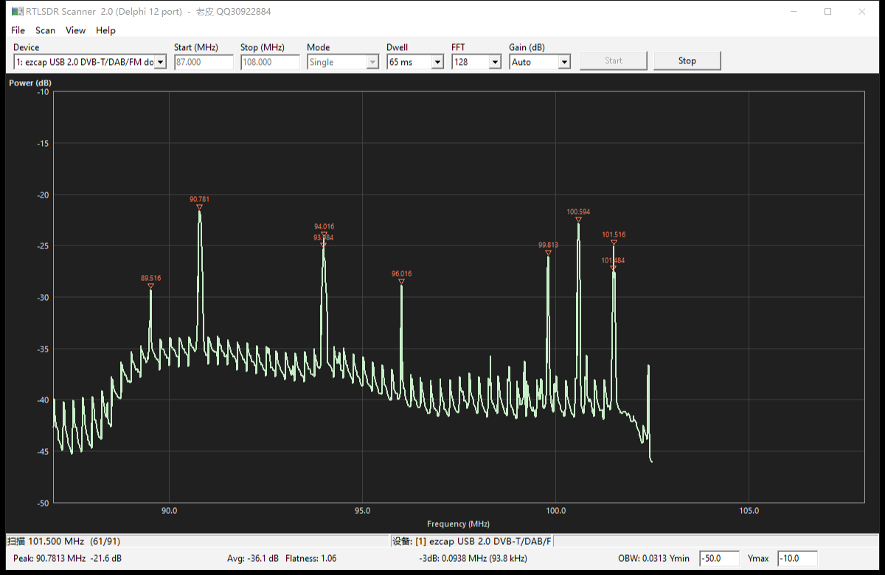

# RTLSDR Scanner — Delphi 12 Port

[简体中文](README.md) | English

A Delphi 12 / VCL port of the Python [RTLSDR-Scanner](https://github.com/EarToEarOak/RTLSDR-Scanner) (v1.0.21959). It talks to `rtlsdr.dll` directly to capture raw IQ data, and implements FFT, Welch PSD, spectrum rendering and peak measurements natively.

- Author: Lao Pi (老皮)
- QQ: 30922884
- Homepage: www.2pascal.com
- GitHub: github.com/shirong21cn



## Features

- Local RTL-SDR USB devices only (rtl_tcp network devices are not supported)
- Single-sweep and continuous scan modes
- Real-time spectrum plot with automatic Y-axis leveling and X-axis tracking
- Readouts: Peak, Avg, HBW, OBW
- Save / load spectrum files (`.rfsx`, compatible with the original `.rfs`)
- Export spectrum data to CSV
- Settings are persisted and restored on the next launch

## Requirements

| Item | Requirement |
|------|-------------|
| OS | Windows 10 / 11 |
| Runtime DLLs | `rtlsdr.dll` (32-bit), `libusb-1.0.dll` |
| Driver | RTL-SDR must have the WinUSB driver installed via Zadig |
| Build toolchain | Delphi 12 (Win32 target) |

Place the DLLs next to the executable or somewhere on `PATH`.

## Usage

1. Plug in the RTL-SDR and make sure the driver is installed.
2. Start the application and pick a device from the **Device** combo box (`Scan → Refresh Devices` rescans).
3. Set **Start / Stop (MHz)**, **Mode** (Single / Continuous), **Dwell** (time per step), **FFT** (number of points) and **Gain**.
4. Click **Start** (F5), and **Stop** (F6) to stop.
5. Use `View → Auto Scale` to re-fit the Y axis.

Shortcuts:

| Shortcut | Action |
|----------|--------|
| F5 | Start scan |
| F6 | Stop scan |
| Ctrl+N | New |
| Ctrl+O | Open spectrum file |
| Ctrl+S | Save |

Settings file: `%APPDATA%\RTLSDRScanner\settings.ini`

## Project layout

```
RtlSdrScanner.dpr        Program entry (unit list, resource directives)
RtlSdrScanner.res        Version / author resource (generated)
RtlSdrScanner.exe        Build output
src\
  SdrTypes.pas           Core types, constants, math helpers
  SdrDevice.pas          Dynamic loading and wrapper for rtlsdr.dll
  SdrDsp.pas             Radix-2 FFT, windows, Welch PSD, peak detection
  SdrSpectrum.pas        Sweep data structures, file I/O
  SdrPlot.pas            Spectrum plot control (axes, grid, cursor)
  SdrEngine.pas          Scan thread and device scheduling
  SdrSettings.pas        INI persistence
  SdrMain.pas            Main window and interaction logic
tools\
  mkver.py               Generates the version-info resource
```

## Building

### IDE

Open `RtlSdrScanner.dpr` in Delphi 12, select the **Win32** target and build.

### Command line

```powershell
dcc32 -B -NSSystem;System.Win;Winapi;Vcl;Data;Xml ^
  -U"C:\Program Files (x86)\Embarcadero\Studio\23.0\lib\Win32\release" ^
  -I"C:\Program Files (x86)\Embarcadero\Studio\23.0\lib\Win32\release" ^
  RtlSdrScanner.dpr
```

### Version information

`RtlSdrScanner.res` is generated by a Python 3 script:

```powershell
python tools\mkver.py
```

> Do not rebuild the version resource with Delphi's bundled `brcc32`. It drops the
> terminating `\0` from `VERSIONINFO` strings and cannot encode non-ASCII text,
> which garbles the file-properties dialog.

## Implementation notes

Module mapping against the original Python project:

| This project | Original |
|--------------|----------|
| `SdrTypes.pas` | `constants.py` / `misc.py` |
| `SdrDevice.pas` | `pyrtlsdr` device wrapper |
| `SdrDsp.pas` | `numpy` FFT + `matplotlib.mlab.psd` |
| `SdrSpectrum.pas` | spectrum data structures and file I/O |
| `SdrPlot.pas` | `matplotlib` plotting |
| `SdrEngine.pas` | `scanner.py` scan flow |
| `SdrSettings.pas` | `settings.py` |
| `SdrMain.pas` | `wx` GUI |

The numerical conventions match the original:

- FFT is an iterative radix-2 implementation; twiddle factors are precomputed and reused across Welch segments.
- PSD is normalized as `|FFT|² / (Fs_MHz · Σw²)`, consistent with `mlab.psd(samples, Fs=SAMPLE_RATE/1e6)` in the original. The IQ signal is complex, so no one-sided ×2 scaling is applied.
- Default window is Hamming with `Overlap = 0.0`, matching `mlab.psd` defaults.

## Known limitations

- Local USB RTL-SDR only; rtl_tcp support has been removed.
- No power calibration: displayed levels are relative dB values consistent with the original, not absolute dBm.
- Only a 32-bit (Win32) build is provided.

## License

This port is derived from a GPLv3 project and is released under the
**GNU General Public License v3.0 or later** (GPL-3.0-or-later).
See [LICENSE](LICENSE) for the full text.

You may use, modify and redistribute it freely; derivative works must also be
open-sourced under GPLv3 with the copyright notices preserved.

## Acknowledgements

Original Python project: [EarToEarOak/RTLSDR-Scanner](https://github.com/EarToEarOak/RTLSDR-Scanner).
Thanks to the original author.
