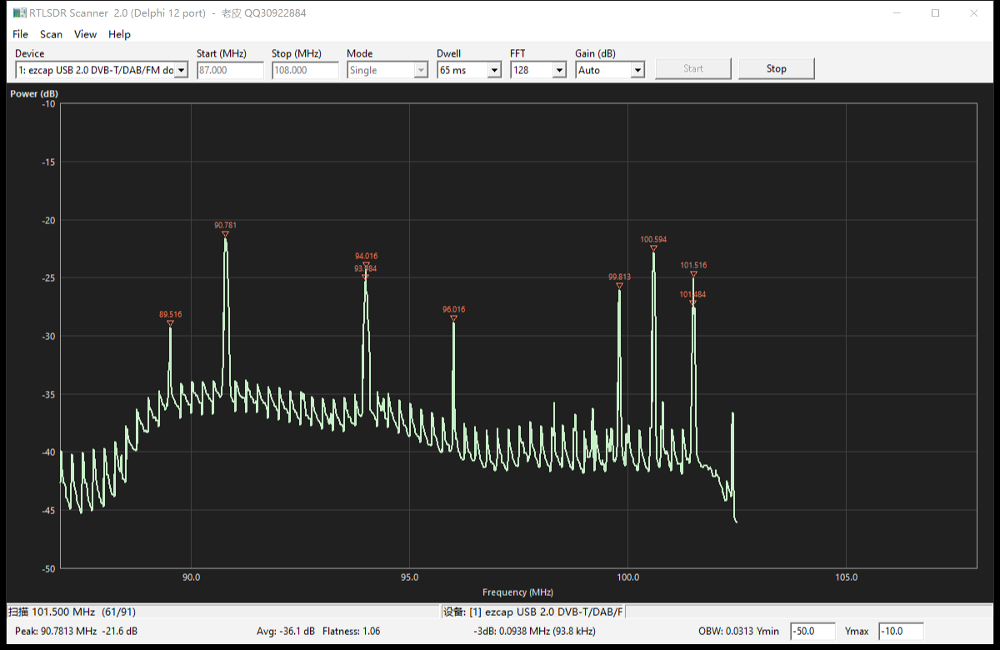

# RTLSDR Scanner — Delphi 12 移植版

简体中文 | [English](README.en.md)

将 Python 版 [RTLSDR-Scanner](https://github.com/EarToEarOak/RTLSDR-Scanner)（v1.0.21959）的频谱扫描功能移植到 Delphi 12 / VCL，直接调用 `rtlsdr.dll` 采集 IQ 数据，自带 FFT、Welch PSD、频谱绘制与峰值测量。

- 作者：老皮
- QQ：30922884
- 主页：www.2pascal.com
- GitHub：github.com/shirong21cn
- 项目地址：  https://github.com/shirong21cn/sdrscaner



## 功能

- 本地 RTL-SDR USB 设备扫描（不支持 rtl_tcp 网络设备）
- 单次扫描 / 连续扫描两种模式
- 实时频谱绘制，Y 轴自动量程、X 轴自动跟随
- 指标显示：Peak、Avg、HBW、OBW
- 频谱保存 / 读取（`.rfsx`，兼容原版 `.rfs`）
- 频谱导出 CSV
- 配置自动保存，下次启动恢复

## 运行环境

| 项目 | 要求 |
|------|------|
| 操作系统 | Windows 10 / 11 |
| 运行时依赖 | `rtlsdr.dll`（32 位）、`libusb-1.0.dll` |
| 驱动 | RTL-SDR 需用 Zadig 安装 WinUSB 驱动 |
| 编译环境 | Delphi 12（Win32 目标） |

DLL 放在 exe 同目录或系统 PATH 中均可。

## 使用

1. 插入 RTL-SDR，确认驱动正常。
2. 启动程序，在 **Device** 下拉框选择设备（点 `Scan → Refresh Devices` 可刷新）。
3. 设置 **Start / Stop (MHz)**、**Mode**（Single / Continuous）、**Dwell**（每步驻留时间）、**FFT**（点数）、**Gain**。
4. 点 **Start**（F5）开始，**Stop**（F6）停止。
5. `View → Auto Scale` 可重新适配 Y 轴量程。

常用快捷键：

| 快捷键 | 功能 |
|--------|------|
| F5 | 开始扫描 |
| F6 | 停止扫描 |
| Ctrl+N | 新建 |
| Ctrl+O | 打开频谱文件 |
| Ctrl+S | 保存 |

配置文件位置：`%APPDATA%\RTLSDRScanner\settings.ini`

## 目录结构

```
RtlSdrScanner.dpr        程序入口（含单元清单与资源指令）
RtlSdrScanner.res        版本信息 / 作者信息资源（自动生成）
RtlSdrScanner.exe        编译产物
src\
  SdrTypes.pas           基础类型、常量、通用数学函数
  SdrDevice.pas          rtlsdr.dll 动态加载与设备封装
  SdrDsp.pas             基 2 FFT、窗函数、Welch PSD、峰值检测
  SdrSpectrum.pas        扫描数据结构、文件读写
  SdrPlot.pas            频谱绘制控件（坐标轴、网格、游标）
  SdrEngine.pas          扫描线程与设备调度
  SdrSettings.pas        INI 配置持久化
  SdrMain.pas            主界面与交互逻辑
tools\
  mkver.py               生成版本信息资源
```

## 编译

### 用 IDE

用 Delphi 12 打开 `RtlSdrScanner.dpr`，目标平台选 **Win32**，Build 即可。

### 用命令行

```powershell
dcc32 -B -NSSystem;System.Win;Winapi;Vcl;Data;Xml ^
  -U"C:\Program Files (x86)\Embarcadero\Studio\23.0\lib\Win32\release" ^
  -I"C:\Program Files (x86)\Embarcadero\Studio\23.0\lib\Win32\release" ^
  RtlSdrScanner.dpr
```

### 版本信息

`RtlSdrScanner.res` 由脚本生成（需要 Python 3）：

```powershell
python tools\mkver.py
```

> 注意：不要用 Delphi 自带的 `brcc32` 重新编译版本信息。它在写 `VERSIONINFO` 时会漏掉字符串结尾的 `\0`，且无法正确嵌入中文，导致文件属性页显示错乱。

## 实现说明

与 Python 原版的模块对应关系：

| 本项目 | 原版 |
|--------|------|
| `SdrTypes.pas` | `constants.py` / `misc.py` |
| `SdrDevice.pas` | `pyrtlsdr` 设备封装 |
| `SdrDsp.pas` | `numpy` FFT + `matplotlib.mlab.psd` |
| `SdrSpectrum.pas` | 频谱数据结构与文件读写 |
| `SdrPlot.pas` | `matplotlib` 绘图 |
| `SdrEngine.pas` | `scanner.py` 扫描流程 |
| `SdrSettings.pas` | `settings.py` |
| `SdrMain.pas` | `wx` 界面 |

关键计算口径与原版保持一致：

- FFT 为基 2 迭代实现，旋转因子预计算并跨 Welch 分段复用。
- PSD 按 `|FFT|² / (Fs_MHz · Σw²)` 归一化，与原版 `mlab.psd(samples, Fs=SAMPLE_RATE/1e6)` 一致；
  IQ 为复数，不做单边谱 ×2。
- 默认窗函数 Hamming，`Overlap = 0.0`，与 `mlab.psd` 默认值一致。

## 已知限制

- 仅支持本地 USB RTL-SDR，rtl_tcp 网络设备已移除。
- 软件未做功率校准，显示电平为与原版一致的相对值（dB），非绝对 dBm。
- 当前仅提供 Win32 构建。

## 许可证

本项目移植自采用 GPLv3 的 Python 原版，按 **GNU General Public License v3.0 或更高版本**（GPL-3.0-or-later）发布，完整条款见 [LICENSE](LICENSE)。

你可以自由使用、修改和再分发；分发衍生作品时需同样以 GPLv3 开放源代码并保留版权声明。

## 致谢

原始 Python 项目：[EarToEarOak/RTLSDR-Scanner](https://github.com/EarToEarOak/RTLSDR-Scanner)，感谢原作者的工作。
